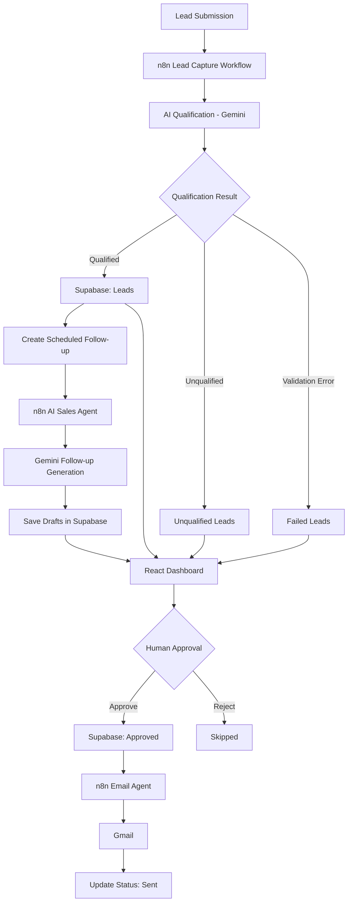

# Leadflow AI — AI-Powered Lead Conversion Platform

<p align="center">
  <strong>Turn better leads into lasting growth.</strong>
</p>

<p align="center">
  <a href="https://leadflow-ai-u2ys.vercel.app">Live Demo</a> ·
  <a href="https://github.com/Yaeeeeshhh/leadflow-ai">GitHub Repository</a>
</p>

## Overview

Leadflow AI is an AI-powered lead qualification and conversion platform designed to help businesses manage incoming prospects, evaluate lead quality, automate follow-ups, and track sales opportunities from a centralized dashboard.

The platform combines a React dashboard, Supabase backend, Gemini-powered AI processing, and n8n workflow automation to streamline the lead management lifecycle while retaining human approval over outbound communication.

## Key Features

### AI Lead Qualification
- Automated lead validation and qualification.
- AI-generated lead scores and qualification reasoning.
- Routing of qualified, unqualified, and failed submissions.
- Recommended actions for sales teams.

### Lead Management
- Centralized lead management dashboard.
- Lead details and activity history.
- Searchable and organized lead records.
- Sales stage management.

### AI Follow-up Generation
- AI-generated WhatsApp follow-up messages.
- AI-generated email subjects and email bodies.
- Scheduled follow-up workflow.
- Human approval before outbound email delivery.

### Email Automation
- Gmail integration for sending approved emails.
- Automated status updates after successful sending.
- Follow-up tracking through Supabase.

### Sales Pipeline
- Visual sales pipeline with stages:
  - New
  - Contacted
  - Interested
  - Converted
  - Lost
- Pipeline activity and conversion metrics.

### Dashboard
- Lead statistics and conversion metrics.
- Lead activity overview.
- Recent leads and recent activity.
- Follow-up management.
- Responsive navigation and authentication.

## Technology Stack

| Layer | Technologies |
|---|---|
| Frontend | React 19, TypeScript |
| Build Tool | Vite |
| Styling | CSS |
| UI Icons | Lucide React |
| Charts | Recharts |
| Data Fetching | TanStack Query |
| Backend / Database | Supabase, PostgreSQL |
| Authentication | Supabase Auth |
| AI | Google Gemini |
| Workflow Automation | n8n |
| Email Delivery | Gmail |
| Hosting | Vercel |
| Version Control | Git, GitHub |

## System Architecture

## System Architecture



## Lead Conversion Lifecycle

1. A prospect submits their information.
2. The n8n capture workflow validates and processes the submission.
3. Gemini evaluates the lead and generates a qualification result.
4. Qualified, unqualified, and failed submissions are stored separately.
5. Qualified leads receive scheduled follow-up records.
6. The AI Sales Agent generates personalized email and WhatsApp drafts.
7. Drafts appear in the dashboard for human review.
8. Approved emails are sent through Gmail.
9. Supabase records the updated follow-up status.

## Database

The application uses Supabase PostgreSQL for persistent storage.

Core tables include:

- `leads`
- `unqualified_leads`
- `failed_leads`
- `lead_activities`
- `organization_memberships`
- `lead_followups`

Row Level Security (RLS) is used to protect organization-scoped data.

## Local Development

### Prerequisites

- Node.js
- pnpm
- Supabase project

### 1. Clone the repository

```bash
git clone https://github.com/Yaeeeeshhh/leadflow-ai.git
cd leadflow-ai
```

### 2. Install dependencies

```bash
pnpm install
```

### 3. Configure environment variables

Create a `.env` file in the project root:

```env
VITE_SUPABASE_URL=your_supabase_project_url
VITE_SUPABASE_PUBLISHABLE_KEY=your_supabase_publishable_key
```

You can use `.env.example` as a reference.

### 4. Start the development server

```bash
pnpm dev
```

### 5. Build for production

```bash
pnpm build
```

The production build is generated in the `dist` directory.

## Deployment

The frontend is deployed through Vercel and connected to the GitHub repository.

Production application:

**https://leadflow-ai-u2ys.vercel.app**

The Supabase project provides authentication and database services, while n8n workflows handle lead processing, AI generation, and email automation.

## Security

- Supabase authentication.
- Organization-scoped data access.
- Row Level Security policies.
- Environment variables for frontend configuration.
- Human approval before email delivery.

Never commit private API keys, service-role credentials, or database passwords.

## Project Goals

Leadflow AI was built to explore how AI agents and workflow automation can improve sales operations by reducing manual lead qualification, streamlining follow-ups, and providing better visibility into the sales pipeline.

The project demonstrates practical integration of frontend engineering, backend services, AI APIs, database design, and workflow automation.

---

**Built with React, Supabase, Gemini and n8n.**
